<div align="center">



[](https://t.me/dryundell)
[](https://career.habr.com/dryundel)
[](https://github.com/DryundeL?tab=repositories)


[About](#about) · [Commercial experience](#experience) · [Stack](#stack) · [Personal projects](#projects)

</div>

---

<a id="about"></a>

## 01 / The engineer behind the code

I'm a **Full-Stack developer with strong backend expertise**, building commercial software since **2021**. My core stack is **PHP/Laravel and Go**; I also build web interfaces with **React and TypeScript**.

At the **Moscow Institute of Psychoanalysis**, I develop services for the InStudy educational ecosystem: authentication, analytics, learning platforms, integrations, and background processing. I contribute to **code reviews, task decomposition, and mentoring a team of up to five developers**.

I like following a feature through its whole journey:

```text
Business workflow → Data model → API & background jobs → Interface → Deployment
```

<a id="experience"></a>

## 02 / Production work · InStudy ecosystem

| Product | My contribution | Stack & context |
| :--- | :--- | :--- |
| **InStudy** | Access control, schedules, learning materials, chats, background jobs, and integration with **1C:University** through a data bus | **PHP / Laravel** · ~25K registered users |
| **Analytics** | Built a platform combining data from four products; reporting APIs, surveys, CQRS/outbox, concurrent data loading, and a web interface | **Go / PostgreSQL** |
| **Centralized SSO** | Develop and maintain shared authentication, profile merging, and access control across services | **PHP / Laravel / Passport / OAuth2** · ~40K registered users |
| **Course Constructor** | Course import/export, archives, chunked uploads, object storage, RabbitMQ, access checks, and tests | **PHP / Laravel** · separate API and queue containers |
| **Marketplace** | Roles, subscriptions, content, file storage, and OpenAPI; resolved N+1 queries and added indexes for course lists | **PHP / Laravel** · ~15K registered users |
| **InStudyGPT** | LLM integrations, streaming responses, and conversation history | **PHP / Laravel** |

**Delivery & collaboration:** Docker, GitLab CI/CD, health/readiness checks, queues, and logging. I configure CI and participate in the **ongoing Kubernetes migration**. I have also configured a metrics service and integration using **NATS + ClickHouse**.

<details>
<summary><b>Performance context & earlier experience</b></summary>

- **instudy-back passed a team load test at 1,000 RPS.** This describes that test, rather than a production SLA; registered-user counts above are not concurrent-user counts.
- **Lazur media · September 2021 – August 2024:** PHP/Laravel development for Career Navigator; APIs, authorization, integrations, CSV/Excel workflows, PDF/DOCX generation, MySQL/Redis, SQL optimization, and PHPUnit. Also maintained an October CMS website and supported Docker/Linux/Nginx delivery workflows.

</details>

<a id="stack"></a>

## 03 / The stack

**Backend & data**


Laravel · Echo · chi · Huma · REST · OpenAPI · OAuth2/SSO · PostgreSQL · MySQL · Redis · RabbitMQ · NATS · ClickHouse · pgx · Goose

**Frontend**


React 19 · TypeScript · Feature-Sliced Design · TanStack Query · Zustand · SSR

**Build, ship, maintain**


Docker Compose · GitLab CI/CD · GitHub Actions · Linux/VPS · Nginx · DNS · HTTPS · PHPUnit · Postman

<a id="projects"></a>

## 04 / Outside the day job

### ReviewHub · Web app & Telegram Mini App

A live, actively developed platform for reviews of digital content. I build the **React/TypeScript frontend** and **Go/Echo backend**, including SSR, profiles, subscriptions, notifications, and background events with transactional outbox.

I also set up the **VPS/Linux environment, DNS, HTTPS/Nginx, SMTP email, Docker Compose, GitHub Actions deployments, Yandex Webmaster, and Google Search Console**.

[Live product](https://review-hub.ru) · [Frontend source](https://github.com/DryundeL/review-app) · [Backend source](https://github.com/DryundeL/review-api)

**Also exploring:** [gRPC authentication in Go](https://github.com/DryundeL/gprc-auth) — a separate learning project using Protocol Buffers and gRPC.

## 05 / How I build

- Start with the workflow, data model, and access rules.
- Keep API contracts explicit and modules focused.
- Use queues, caching, and concurrency where the workload calls for them.
- Optimize SQL and test critical behavior.
- Make deployment and production diagnostics part of the work.

---

<div align="center">

**Have a product to build or a service to improve?**

[Let's talk on Telegram](https://t.me/dryundell)

</div>
