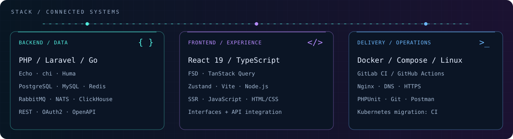
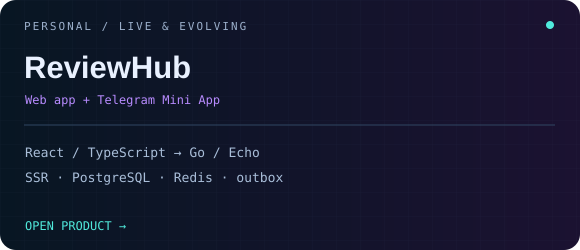
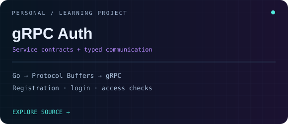
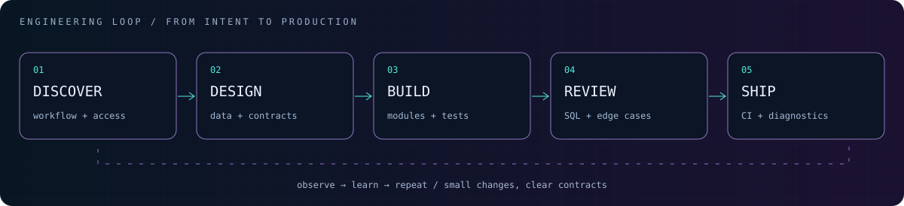
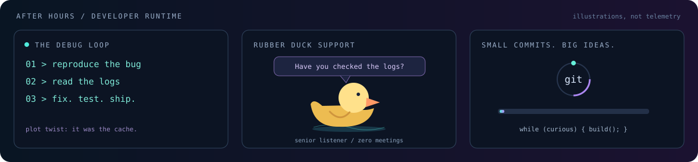

<div align="center">


[](https://t.me/dryundell)
[](https://career.habr.com/dryundel)
[](https://github.com/DryundeL?tab=repositories)


[About](#about) · [Commercial experience](#experience) · [Stack](#stack) · [Personal projects](#projects) · [Debug mode](#playground)

</div>

---

<a id="about"></a>

## 01 / The engineer behind the code

I'm a **Full-Stack developer with strong backend expertise**, building commercial software since **2021**. My core stack is **PHP/Laravel and Go**; I also build web interfaces with **React and TypeScript**.

At the **Moscow Institute of Psychoanalysis**, I develop services for the InStudy educational ecosystem: authentication, analytics, learning platforms, integrations, and background processing. I contribute to **code reviews, task decomposition, and mentoring a team of up to five developers**.

I like following a feature through its whole journey:

```text
Business workflow → Data model → API & background jobs → Interface → Deployment
```

<a id="experience"></a>

## 02 / Production work · InStudy ecosystem

| Product | My contribution | Stack & context |
| :--- | :--- | :--- |
| **InStudy** | Access control, schedules, learning materials, chats, background jobs, and integration with **1C:University** through a data bus | **PHP / Laravel** · ~25K registered users |
| **Analytics** | Built a platform combining data from four products; reporting APIs, surveys, CQRS/outbox, concurrent data loading, and a web interface | **Go / PostgreSQL** |
| **Centralized SSO** | Develop and maintain shared authentication, profile merging, and access control across services | **PHP / Laravel / Passport / OAuth2** · ~40K registered users |
| **Course Constructor** | Course import/export, archives, chunked uploads, object storage, RabbitMQ, access checks, and tests | **PHP / Laravel** · separate API and queue containers |
| **Marketplace** | Roles, subscriptions, content, file storage, and OpenAPI; resolved N+1 queries and added indexes for course lists | **PHP / Laravel** · ~15K registered users |
| **InStudyGPT** | LLM integrations, streaming responses, and conversation history | **PHP / Laravel** |

**Delivery & collaboration:** Docker, GitLab CI/CD, health/readiness checks, queues, and logging. I configure CI and participate in the **ongoing Kubernetes migration**. I have also configured a metrics service and integration using **NATS + ClickHouse**.

<details>
<summary><b>Performance context & earlier experience</b></summary>

- **instudy-back passed a team load test at 1,000 RPS.** This describes that test, rather than a production SLA; registered-user counts above are not concurrent-user counts.
- **Lazur media · September 2021 – August 2024:** PHP/Laravel development for Career Navigator; APIs, authorization, integrations, CSV/Excel workflows, PDF/DOCX generation, MySQL/Redis, SQL optimization, and PHPUnit. Also maintained an October CMS website and supported Docker/Linux/Nginx delivery workflows.

</details>

<a id="stack"></a>

## 03 / The stack



<details>
<summary>🟢 BACKEND / DATA — open the toolbox</summary>

**PHP 8 / Laravel · Go / Echo / chi / Huma**

REST · OpenAPI · OAuth2/SSO · PostgreSQL · MySQL · Redis · RabbitMQ · NATS · ClickHouse · pgx · Goose

API and database design, modular services, CQRS, transactional outbox, background jobs, and SQL optimization.

</details>

<details>
<summary>🟣 FRONTEND / EXPERIENCE — inspect the interface</summary>

**React 19 / TypeScript · JavaScript · HTML / CSS**

Feature-Sliced Design · TanStack Query · Zustand · Vite · Node.js · SSR

Hands-on React/TypeScript work in personal projects, alongside contributions to commercial analytics interfaces.

</details>

<details>
<summary>🔵 DELIVERY / OPERATIONS — follow the deployment</summary>

**Docker / Docker Compose · Linux / VPS · Nginx**

GitLab CI/CD · GitHub Actions · DNS · HTTPS · PHPUnit · Git · Postman

I set up application delivery and services, configure CI, and participate in the ongoing Kubernetes migration.

</details>

<a id="projects"></a>

## 04 / Outside the day job

<table>
<tr>
<td width="50%" valign="top" align="center">
<a href="https://review-hub.ru"></a>
<p><a href="https://review-hub.ru">Live product ↗</a> · <a href="https://github.com/DryundeL/review-app">Frontend ↗</a> · <a href="https://github.com/DryundeL/review-api">Backend ↗</a></p>
</td>
<td width="50%" valign="top" align="center">
<a href="https://github.com/DryundeL/gprc-auth"></a>
<p><a href="https://github.com/DryundeL/gprc-auth">Explore source ↗</a></p>
</td>
</tr>
</table>

<details>
<summary>🟢 ReviewHub / open build notes</summary>

A live, actively developed platform for reviews of digital content: **web app and Telegram Mini App**.

- **Interface:** React/TypeScript, FSD, TanStack Query, Zustand, Vite/Node.js SSR, profiles, subscriptions, and notifications.
- **Services:** Go/Echo, PostgreSQL/pgx, Goose, Redis, and background events using transactional outbox.
- **Delivery:** self-configured VPS/Linux, DNS, HTTPS/Nginx, SMTP email, Docker Compose, GitHub Actions deployments, Yandex Webmaster, and Google Search Console.

</details>

<details>
<summary>🟣 gRPC Auth / open experiment notes</summary>

A separate **Go learning project** exploring service contracts with **Protocol Buffers and gRPC**, including registration, login, and access checks.

</details>

## 05 / How I build



<details>
<summary>01 / DISCOVER — understand the workflow</summary>

Start with the business workflow, the people using it, the data involved, and the access rules. Identify failure cases before turning the workflow into code.

</details>

<details>
<summary>02 / DESIGN — make the boundaries clear</summary>

Keep API contracts explicit, model the data deliberately, and give modules focused responsibilities. Choose queues, caching, and concurrency when the workload calls for them.

</details>

<details>
<summary>03 / BUILD — implement in small steps</summary>

Keep changes focused, integrate with existing conventions, and test critical behavior. Treat the interface, API, and background work as parts of one feature.

</details>

<details>
<summary>04 / REVIEW — look beyond the happy path</summary>

Review access control, SQL queries, edge cases, failure handling, and maintainability. Make the change easy for another developer to understand.

</details>

<details>
<summary>05 / SHIP — delivery is part of the feature</summary>

Automate application delivery, include health checks and useful logs, and keep production diagnostics part of the work. Observe the result and feed what you learn into the next change.

</details>

<a id="playground"></a>

## 06 / Debug mode: on



<details>
<summary>🕹️ You found the developer console. Click to open.</summary>

```text
$ developer --help

  --debug       explain the bug to the duck
  --cache       the bug might still be the cache
  --deploy      one small, reviewable commit at a time
  --coffee      refill before retrying

Achievement unlocked: you actually read the README. 🏆
```

</details>

---

<div align="center">

**Have a product to build or a service to improve?**

[Let's talk on Telegram](https://t.me/dryundell)

</div>
